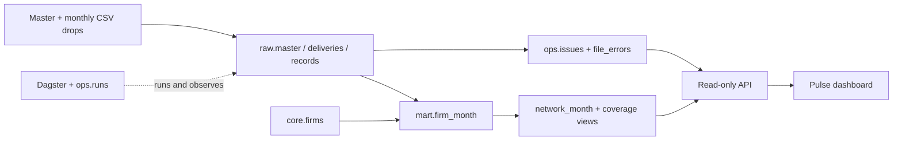

# Pulse Data Platform

Pulse Data Platform is a portfolio project for auditable data engineering: CSV deliveries → validated monthly metrics
→ read-only API and dashboard, plus two optional Phase 2 agents for business queries
and revenue investigation. Runs locally or on an on-premise Docker host. Phase 1
and the explicit agent demo work without a cloud account or model API key.

The public edition uses wholly synthetic firms and metrics, generated locally with
deliberate corrections, duplicates, invalid rows and coverage gaps. No real customer
data is included. The intended demo covers 500 fictional firms over April 2023–March
2026; `data/manifest.json` is authoritative for the generated fixture's exact inventory,
checksums and expected results. Counts are not inferred from earlier development runs.

Read [synthetic provenance and preserved history](docs/public-edition.md), the
[data contract](docs/data-contract.md), and the [implementation walkthrough](docs/walkthrough.md).
**Status: pending fresh public edition verification.** The
[verification guide](docs/verification.md) defines the checks and evidence to record.

## Start

Prerequisite: Docker Engine/Desktop with Docker Compose v2 and Linux containers.
The first build needs internet access to download public images and pinned packages.
Allow roughly 4 GB of available RAM and a few GB of disk space. From this repository:

```sh
docker compose up
```

Compose creates PostgreSQL, applies checksum-verified migrations, loads the synthetic
data through Dagster, and starts the API/dashboard, Dagster UI and scheduler daemon.
No `.env` file or manual database setup is needed. Startup waits for healthy database
and successful bootstrap. For background mode: `docker compose up -d --build --wait`.

The playback lab does **not** start with the default command. It is opt-in: use
`docker compose --profile lab up -d --build --wait lab` when you want it on port 8001.

Known input-quality failures do not hide the diagnostics. If ingestion committed a
verified, internally consistent publication, bootstrap can start the API and Dagster
UI while the ingestion remains visibly **FAILED** in Dagster. This includes a valid
empty publication when every supplied row/file was rejected. The quality endpoints
explain what happened. Manual `pulse ingest` still exits unsuccessfully for those
outcomes; migration, infrastructure and unexpected integrity failures block startup.

- Dashboard: [localhost:8000](http://localhost:8000)
- Agent workbench: [localhost:8000/agents](http://localhost:8000/agents) — business questions and revenue investigation
- Interactive API documentation: [localhost:8000/docs](http://localhost:8000/docs)
- Dagster: [localhost:3000](http://localhost:3000) — asset `monthly_metrics`, job `ingest_all`

The dashboard's **Desde / Hasta** dropdowns list available metric months by year.
Both endpoints are inclusive. **Últimos 3 / 6 / 12 meses** apply a range ending at
the latest available data month, not today's date; **Todo el histórico** clears
the date limits. The firm selection is retained. The data contract defines one source
row per firm/month, so daily metrics cannot be inferred.

To ingest again, including newly added files:

```sh
docker compose run --rm bootstrap pulse ingest
```

Place new deliveries in `data/drops/`. The directory is mounted read-only in the
application containers; no image rebuild is necessary for new CSV files. Write to
a temporary filename such as `.partial`, then atomically rename it to `.csv` once
the delivery is complete. Do not write an unfinished delivery directly to a `.csv` path.

The enabled Dagster **`csv_delivery_sensor`** checks the folder at a minimum interval
of 30 seconds. A file must have the same size, modification timestamp and SHA-256 in
two consecutive observations before it becomes eligible. New stable files are batched
into one `ingest_all` run with explicit filenames and expected checksums. Typically
pickup takes around 30–60 seconds plus daemon/queue overhead; it is not a latency SLA.
Open Dagster → Automation → Sensors to inspect ticks, skip reasons, runs or pause it.

The sensor consults the ingestion ledger, so loaded files and unchanged quarantined
contents do not trigger repeated ingestion. Its persisted cursor and run keys deduplicate
repeated observations. It defers while an ingestion job is queued or active, and the
database lock still protects overlapping entry points. A file changed after inspection
fails its expected-checksum check before archival. Two stable observations are a heuristic;
the producer's atomic rename is the file-completion contract.

Transient ingestion/publication exceptions receive two step retries, five seconds apart.
Known file-quarantine outcomes fail visibly without automatic step retries. Fix the input
or re-execute the failed run in Dagster. An exhausted unchanged arrival is not endlessly
resubmitted by the sensor. The daily **06:00 Europe/Madrid** schedule and manual full-run
command remain available for reconciliation and recovery, including archived data whose
publication previously failed. The lab's playback stays manual and isolated; this sensor
does not automatically fill the lab database.

Manual/bootstrap ingestion has a hard 15-minute process budget. Dagster monitoring
enforces 16-minute start/runtime budgets with a 30-second poll, so an interrupted
run cannot hold the one-run queue indefinitely while the daemon and database remain
available. This is an explicit MVP execution limit, not proof that a worker died.
Scheduled/UI workers have the same 16-minute runtime budget. Failed runs are visible;
the next full ingestion reconciles retained raw data and marks abandoned `ops.runs`
entries. Increase these budgets together if measured workloads require longer runs.

By default, only loopback ports 8000 and 3000 are exposed. PostgreSQL has no published
port. If those ports are busy, set `PULSE_PORT` and/or `DAGSTER_PORT` in your environment
or in a local `.env` file; `LAB_PORT` overrides the optional lab's default 8001.
The public Compose project is `pulse-portfolio`, with runtime image
`pulse-portfolio-app:local`, so its containers, networks and named volumes are
separate from other deployments. For side-by-side use, set all three ports before
starting it, for example in PowerShell:

```powershell
$env:PULSE_PORT = "8100"
$env:DAGSTER_PORT = "3100"
$env:LAB_PORT = "8101"
docker compose up -d --build --wait
```

Run commands from this public checkout and use those overridden ports for browser
URLs and HTTP checks. See [verification](docs/verification.md) for explicit targets.
The checked-in credentials are local demonstration defaults.
Before opening this service on an office network, configure real secrets, HTTPS and
authentication/authorization; Dagster is an administrative interface.

Stop without losing data: `docker compose down`. PostgreSQL's named volume retains
the data and Dagster run history. **Destructive clean reset:** `docker compose down -v`
removes this Compose project's database volume; use only when intentionally rebuilding.

## Components and why they exist

| Component | Responsibility | Choice |
|---|---|---|
| Python CSV adapters | Read two explicit contracts, parse precise numeric values and validate rows | Small, pure functions that can be tested without a database; no dataframe framework needed at demo scale |
| PostgreSQL | Raw archive, quality audit, firm dimension and monthly facts | One transactional system supports provenance, atomic publication and the API |
| SQL migrations | Version database schemas and reporting views | Numbered, checksum-verified files; applied transactionally under a migration lock |
| Dagster OSS | File sensor, daily schedule, manual reruns, persisted execution logs and asset check | Makes ingestion state and failures inspectable without a cloud service |
| FastAPI | Read-only metrics and operational endpoints with OpenAPI | Shared Python codebase, parameter validation and bounded queries |
| HTML/CSS/JavaScript | Single internal view consuming the API | No frontend build chain, CDN or extra service; design stays focused on numbers and quality |
| Docker Compose | Provision and connect all local services | Packages local startup, isolated storage and service dependencies |
| pytest + Ruff + GitHub Actions | Check correctness, code style and image builds | Verification covers PostgreSQL and the actual Compose stack; current results belong in the verification record |

See [the implementation walkthrough](docs/walkthrough.md) for the engineering
explanation and [the data contract](docs/data-contract.md) for every quality decision.

## Repository layout

The repository separates `backend/`, `frontend/` and `docs/`, with numbered
directories for the main backend responsibilities:

```text
pulse-data-platform/
├── backend/
│   ├── 00_infrastructure/
│   │   ├── Dockerfile          # Runtime and test image targets
│   │   ├── dagster/            # Instance storage, queue and code-location config
│   │   └── postgres/           # Initial databases and reader roles
│   ├── 01_pipeline/
│   │   └── src/pulse/
│   │       ├── parsing.py      # CSV contracts and quality rules
│   │       ├── ingest.py       # Raw archival and atomic reporting publication
│   │       ├── db.py           # Connections and migration runner
│   │       ├── cli.py          # pulse bootstrap / migrate / ingest
│   │       ├── definitions.py  # Dagster asset, job, check and schedule
│   │       ├── file_sensor.py  # Stable-file discovery and dispatch
│   │       ├── migrations/    # Main database schema and reporting views
│   │       └── lab_migrations/ # Optional playback/reader database extensions
│   ├── 02_api/
│   │   └── src/pulse_api/
│   │       ├── app.py          # Read-only reporting API and dashboard hosting
│   │       ├── models.py       # Public response contracts
│   │       ├── assets.py       # Locations of the frontend source trees
│   │       ├── lab_api.py      # Playback and SQL HTTP endpoints
│   │       ├── lab.py          # Durable playback worker and evidence
│   │       └── lab_sql.py      # Bounded read-only PostgreSQL execution
│   ├── 03_scripts/             # Synthetic generation, profiling and smoke checks
│   ├── 04_agents/              # Typed planning, analytical tools and durable agent runs
│   ├── tests/                  # Python unit and PostgreSQL integration tests
│   ├── pyproject.toml          # One Python distribution containing the three packages
│   └── requirements*.in/.txt   # Dependency inputs and pinned lock files
├── frontend/
│   ├── 01_dashboard/           # public/ assets and tests/ for the main dashboard
│   ├── 02_lab/                 # public/ assets and tests/ for playback and SQL
│   ├── 03_agents/              # public/ workbench and DOM tests for both agents
│   ├── 04_tests/               # Read-only test results dashboard and DOM tests
│   └── package.json            # Shared development-only frontend verification
├── data/                       # Generated synthetic master, drops/ and manifest
├── docs/                       # Architecture, provenance, contracts and verification
├── .github/workflows/          # Clean-environment CI verification
└── compose.yaml                # Root entry point: docker compose up
```

`01_pipeline` owns business rules and storage. `02_api` imports those rules for the
lab and reads the reporting tables; the pipeline never imports the HTTP application.
The Python package names are `pulse`, `pulse_api` and `pulse_agents`: numeric directory prefixes
organize the repository and are not part of import paths. One backend dependency
lock and distribution keep the runtime coherent without duplicated library versions.

The dashboard and lab are plain HTML/CSS/JavaScript. FastAPI serves their `public/`
directories; Docker copies them to `/app/frontend` and sets `PULSE_FRONTEND_DIR`.
The lab reuses the dashboard's base stylesheet/fonts at `/static` and serves its
own controls at `/lab-static`. Node is used only for formatting and DOM tests.
No frontend build or separate web server is needed to start the delivered system.

The Compose entry point and source data stay at the repository root. SQL migration
names and contents are preserved, so reorganizing source files requires no database
reset or migration rewrite. Infrastructure configuration here targets the on-premise
Compose deployment. The lab is an optional application with its own verification steps.

## Data model and execution

See the [complete database map and query guide](docs/database-map.md) for all
application tables, foreign keys, views, the CSV-to-API flow and main/lab boundaries.
[Copyable PostgreSQL queries](docs/database-queries.sql) cover satisfaction,
rejections, revenue and source lineage.



The business grain is one firm per month. Synthetic input files and their exact CSV values
are retained alongside normalized records, their validation policy version and
their source line. The published row links directly to its winning source record.
The master is a current/static dimension; it cannot support historical staff counts
or historical province changes absent from the source contract.

1. Acquire a database advisory lock and record the run.
2. Validate/load the clean master; preserve its original bytes.
3. Discover CSV files and compare checksums with the delivery ledger.
4. Archive and validate each new delivery in its own transaction.
5. Atomically rebuild the small reporting fact from all accepted historical versions.
6. Record completion and check that every published row has an accepted source.

Delivery precedence is `(filename delivery month, explicit revision)`, independent
of ingestion order. Repeated files do not duplicate raw rows or issues. A run always
creates a new operational audit entry, even when all files are skipped: idempotence
means identical business results and source inventory, not suppressing execution logs.

Reporting publication uses a transaction with DELETE + INSERT, so readers see an old
or new complete fact table, never a partially filled table. Raw archival transactions
survive a subsequent publication failure; the last successful reporting state remains
available. A retry republishes from that retained raw history. File-level errors are
retained with bytes; a partial run publishes valid inputs but signals failure in Dagster.
Row rejections are expected quality outcomes, reported explicitly rather than crashing
every run. A crashed worker's abandoned run is marked on the next lock-owning attempt.

At this size, incremental raw ingestion plus a deterministic reporting rebuild is
easier to validate than incremental aggregate updates. There is no Kafka, Spark,
Kubernetes or dbt dependency; they would add operational burden without solving a
current requirement. SQL transformation code is versioned in Git and tested in CI.

## Optional CSV playback lab

Start a separate, initially empty lab alongside the normal dashboard:

```sh
docker compose --profile lab up -d --build --wait lab
```

Open **http://localhost:8001** (or the dashboard's **Laboratorio** link). The lab has
its own PostgreSQL service, Docker network and persistent volume. Its writer cannot
address the main database through that network. `LAB_PORT` changes the browser port.
The synthetic CSV mount remains read-only. Starting the lab loads the firm master,
but does not ingest any monthly delivery until requested.

1. Move the playhead to a delivery. Scrubbing never writes or rewinds the database.
2. Choose **Seleccionar hasta el cursor**, individual checkboxes, or **Todos**.
3. Reorder the selected queue with ↑/↓ or **Invertir selección** to test late arrivals.
4. Choose a delay and **Reproducir selección**, or load just the CSV at the cursor.
5. Watch counts, monthly totals, quality issues and per-file evidence update live.
6. Replay the same selection. Files should say **Omitido**, with unchanged raw counts
   and the same business-data SHA-256. A new execution audit record is still expected.

The **Resumen del laboratorio** below the timeline shows the same revenue, active
client and coverage definitions as Home, using only `pulse_lab`. It follows the latest
metric month by default; **Mes consultado** pins an earlier month while new files
arrive. The revenue chart covers the full published interval, including gaps. These
are monthly values, not a sum of client balances across months. Rejections cover all
lab loads. The existing one-second state refresh reads metrics and playback evidence
in one database snapshot; connection failures clear the topline until it reconnects.

Pause and stop finish the current CSV before taking effect. Resume preserves the
remaining queue; after a process restart, interrupted work becomes paused and can
be retried. The request UUID makes an HTTP submission retry return the same job.
Only one active playback is allowed, and the existing ingestion advisory lock still
protects publication. Playback controls accept only catalog filenames, never client paths or SQL.

Each CSV calls the **same `ingest()` function** as the production Dagster asset, with
an explicit file selection and lab database connection. The lab's durable playback
worker replaces the schedule for this experiment; it does not claim these interactive
runs appear in the main Dagster instance. Parsing, archival, validation, winner selection
and atomic publication are shared. Raw ingestion inserts only unseen deliveries;
reporting still rebuilds transactionally at this small volume.

Evidence records added/changed/removed firm-months, before/after raw counts and business
hashes, run IDs, and checks for unique keys, accepted sources and latest-valid winners.
Business hashes exclude execution/source row IDs so differing arrival orders can be
compared. They are verification fingerprints, not tamper-proof audit signatures. A retry
after failed publication may skip an already archived file while repairing reporting;
that case is labeled **Recuperación**, not an unchanged replay.

**Reiniciar laboratorio** explicitly confirms clearing only lab deliveries, reporting
and playback history; it retains the master and source files. It is disabled during an
active file. Moving the playhead backwards never performs this reset. Read-only metric,
quality and lineage APIs are also available on port 8001, against the lab database.

The optional lab is a local development tool with polling once per second and no user
authentication. The loopback binding, same-origin action header and fixed DB connection
are intentional; it is not a multi-user production ingestion control plane.

The verification workflow includes forward playback, reverse replay and automatic
file pickup through the Dagster daemon. Those checks require disposable state;
the sensor check adds a temporary revision. Follow the
[verification guide](docs/verification.md) and retain fresh results for this fixture.

### Query the lab with PostgreSQL

Open **http://localhost:8001/#sql-console** or click **SQL** in the lab header.
Write a query and press **Ejecutar SQL** or **Ctrl/Command + Enter**. If text is
selected, only that selection runs. The schema browser lists actual tables, columns,
types and primary keys; click a name to insert it at the cursor. **Ver plan** runs
EXPLAIN without ANALYZE. Examples insert editable SQL and never execute automatically.
The browser retains the editor draft locally. Results are a snapshot taken when you
run the query; run it again to see deliveries loaded since then.

```sql
SELECT f.asesoria_id, f.mes, f.clientes_activos,
       f.facturacion_asesoria_eur, d.filename AS source_csv, r.line_number
FROM mart.firm_month f
JOIN raw.records r ON r.id = f.source_record_id
JOIN raw.deliveries d ON d.id = r.delivery_id
ORDER BY f.mes DESC, f.asesoria_id;
```

`core.firms` contains the master even before playback. `raw.deliveries` and
`raw.records` show archived inputs and versions; `mart.firm_month` shows the current
winning record per firm/month. `ops.issues` explains validation and `ops.runs` shows
loaded/skipped files per execution. `lab.jobs` and `lab.steps` expose playback evidence.
Repeated firm/month keys across raw deliveries can be legitimate corrections;
the published fact has a unique `(asesoria_id, mes)` key.

The editor sends SQL directly to PostgreSQL using `pulse_reader`, with a read-only
transaction that is rolled back after each request. PostgreSQL's
[DECLARE grammar](https://www.postgresql.org/docs/17/sql-declare.html) accepts SELECT,
WITH, VALUES and TABLE queries; extended-protocol preparation rejects multiple statements.
Use the plan button instead of writing EXPLAIN in the editor. No owner credentials,
DDL/DML, transaction control or psql backslash commands are exposed through this endpoint.
The main dashboard has no SQL endpoint.

Queries have a five-second deadline, two simultaneous execution slots, a maximum of
1,000 displayed rows and a 2 MB returned-value budget. Truncation is explicit; aggregate,
filter or paginate in SQL to inspect larger results. Values use PostgreSQL's text
representation, preserving decimal/bigint precision, JSON and duplicate column names;
NULL stays distinct from an empty string. Query errors include PostgreSQL's SQLSTATE.

For a terminal session in the same read-only database:

```sh
docker compose exec lab-db psql -U pulse_reader -d pulse_lab
```

## Reporting API

| Endpoint | Returns |
|---|---|
| `GET /health` | Database/schema reachability |
| `GET /api/v1/firms?search=...` | Firm directory |
| `GET /api/v1/firms/{id}/metrics?start=YYYY-MM&end=YYYY-MM` | Monthly series, missing-month markers and winning source |
| `GET /api/v1/network/metrics?start=YYYY-MM&end=YYYY-MM` | Monthly totals, coverage and contributor counts |
| `GET /api/v1/quality/summary` | Raw/accepted/rejected/duplicate/published counts, last run and last incorporation |
| `GET /api/v1/quality/deliveries` | Per-file counts, format version and checksum |
| `GET /api/v1/quality/runs` | Execution history, timestamps and outcomes |
| `GET /api/v1/quality/issues?severity=error&firm_id=...` | Original values, filename, line and rejection/warning reasons |
| `GET /api/v1/quality/gaps` | Missing eligible firm-months |
| `GET /api/v1/quality/file-errors` | Malformed or mutated file incidents, including resolution status |
| `GET /api/v1/lineage/{id}/{YYYY-MM}` | Delivery versions, reasons and the selected source record |
| `GET /api/v1/investigations/{id}/{YYYY-MM}` | Independent source-to-API revenue reconciliation |

List responses use `{items,total,limit,offset}`; limit is 1–500. Month bounds are
inclusive. Invalid parameters return 422, unknown firms return 404. Money is an
exact decimal string in JSON. Missing data is NULL, not zero. A missing-month gap
differs from a legitimate record containing zero values. The API connects with a
database reader role, starts read-only transactions and enforces a query timeout.

The screen shows the last month's values within the selected range, not a misleading
sum of active customers over time. Quality counts refer to ALL ingested deliveries,
as explicitly labeled, independently of the chart filter.

The dashboard uses color for coverage, quality and selection state. Inter Tight and
JetBrains Mono are bundled locally with their SIL Open Font Licenses in
`frontend/01_dashboard/public/`; loading the dashboard makes no font/CDN requests. Scrollable
tables retain their column headers, and coverage/error colors reflect API values.

## Verification and development

**Pending fresh public edition verification.** Historical test runs, browser checks
and model evaluations are not evidence for the synthetic public fixture. Follow
[the verification guide](docs/verification.md) for generation checks, PostgreSQL
integration tests, HTTP reconciliation, replay, frontend checks and disposable-stack
smokes. Record the tested revision, fixture manifest, commands, outcomes and failures.

The optional [Tests page](http://localhost:8000/tests/) displays local reports from
`python backend/03_scripts/test_dashboard.py`. It cannot execute tests itself. Reports
include run timestamps and revision information; absent or stale reports are not a
pass. The runner needs Python, Docker Compose, Node 24+ and the public application.
Set `PULSE_TEST_URL` to its URL when using a port other than 8000. It uses the separate
`pulse_test` database. See the verification guide before running it alongside another deployment.

Dependencies are pinned in `backend/requirements*.txt`. From `backend/`, update the
adjacent `.in` files and regenerate with pip-tools under Python 3.12 using
`pip-compile --allow-unsafe requirements.in` and
`pip-compile --allow-unsafe requirements-dev.in`, then run the verification workflow.
`--allow-unsafe` keeps the setuptools runtime/build dependency in the lock. Dagster's
PostgreSQL metadata connection uses psycopg2; business ingestion uses psycopg 3.
SQLAlchemy 2.0 is pinned for the selected Dagster release.

## Design decisions and limitations

### Deployment scope

The bounded Phase 2 agents are included. Document indexing, fine-tuning, host
provisioning, SSO, production secret management, managed backups, external alerts
and multi-node availability remain outside the current scope.
For an office deployment, add reverse-proxy authentication, secrets, encrypted backups
with restore drills, resource limits and failure notifications. Agree business ownership
of the quality rules before tightening them. A changed master currently needs an
explicit controlled migration; add versioned master deliveries/SCD only when required.

The Dockerfiles and `compose.yaml` version the application environment: service
images, configuration, container networks, persistent volumes and startup dependencies.
They assume an existing Docker-ready host; they do not provision VMs or configure
the host OS, firewall or backup destination. Infrastructure as code is useful on
premises too, but adding Terraform just to duplicate Compose would add another
tool without addressing those host-level gaps. With an agreed deployment target, automate host setup
and add VM, network and storage provisioning against that platform where needed.

### Producer contract and completeness

The producer contract: filenames currently encode delivery order, monthly revenue
is assumed nonnegative, and ingestion has no producer completeness contract. The
synthetic fixture's `data/manifest.json` records generation expectations; it is not
an ingestion protocol for acknowledging external deliveries. Unknown schemas and
mutated deliveries fail visibly, but no pipeline can infer an undocumented correction's
intent. First improvement: a producer manifest with immutable delivery ID, revision,
schema version, expected firm coverage and checksum, agreed with the source owner.
Then add operational alerts. The daily schedule cannot discover files absent from disk;
missing expected deliveries need a delivery-calendar SLA, not a guessed warning.

### Investigating incorrect revenue

1. Retrieve its firm-month API response and `/lineage/{id}/{month}`.
2. Inspect the selected record, competing deliveries and quality decisions. Check for
   a rejected newer correction or missing revenue category.
3. Compare normalized numeric fields with the raw payload, source filename, CSV line
   and archived file checksum. If the source is wrong, request a new delivery/revision.
4. Compare `mart.firm_month` with the expected Decimal sum and winning version. A mismatch
   here is parsing, validation or precedence logic; add a regression fixture, fix and replay.
5. Compare API JSON with SQL results. A mismatch here is query/serialization logic;
   correct it and test the endpoint. Finally inspect dashboard formatting/filtering.

The source is never silently edited to make a test pass.

This procedure is executable through the deterministic investigation endpoint.
It returns each comparison, exact SQL, source evidence and explicit uncertainty.
Metrics expose their publication ID so simultaneous corrections cannot create a
false API mismatch. See [the service design and limits](docs/investigation-service.md).

### Scaling to 5,000 firms submitting daily

5,000 daily metric rows is still modest for PostgreSQL. The first problems are likely
file count/coordination, re-reading all files to checksum them, Python row-by-row audit
insertion, and rebuilding an ever-growing fact under one writer lock. Measure before
introducing distributed compute.

Introduce immutable manifests and event-driven file discovery, archive file bytes in
object storage or an on-premise compatible store, load staging in bulk with COPY, and
update only affected firm-month keys using explicit delivery precedence. If the business
grain becomes DAILY, create a daily fact and define how monthly stocks/flows aggregate;
do not just rename the monthly column. Partition history when measured retention/size
warrants it, add API pooling/caching and richer source SLAs. Scale workers by nonoverlapping
delivery keys, keeping publication transactional and retries idempotent.

## Phase 2 agents

Open `/agents` from the dashboard's **Agentes** link. The chat has an agent switcher,
a bottom composer and saved conversations in the left sidebar. Choose Business assistant
for metrics or Data investigator for one firm's revenue in one month. Each chat
keeps its own context. **Enter** sends; **Shift + Enter** inserts a new line.
The expandable exact investigation form accepts a numeric firm ID
and a calendar month. **Run investigation** checks the current publication directly
without a model call, including in demo mode. Free-form questions use **Send**.
Expand **View data & sources** or **View investigation & source evidence** for
SQL, coverage, findings, source versions and the
raw evidence to inspect the answer. The workbench uses the main reporting database;
the CSV playback lab remains separate. **Execution details** contains the plan,
model, timing, estimated cost and request identifiers.

Conversation history lives in PostgreSQL, survives page reloads and is read without
calling a model. Reopen a conversation to continue its existing context; **New
conversation** starts separately without deleting the previous chat. The sidebar
loads 30 chats at a time and searches the loaded titles; message history loads the
latest 10 turns first, with **Load earlier messages** for older turns. On a phone,
**Conversations** opens the history panel. Unsent drafts remain in page memory only;
tokens and transcripts are not persisted in browser storage.

If a response is lost, **Recover request** reuses the exact original request ID and
payload. **Start new execution** deliberately creates another run. Model cost is an
estimate, and unknown usage is shown as unavailable. Changing deployment credentials
clears visible conversations from the page and discards late responses from the old
identity. The optional access field is for deployment authentication, not an OpenAI key.
Rechecking service status also invalidates cached chats if the identity's permissions
change. The default local deployment has one shared operator identity; it does not
provide separate histories for different people sharing that local application.

`GET /api/v1/agents/conversations` lists authorized chats; `GET
/api/v1/agents/conversations/{id}` reads saved turns. Both paginate and disallow
HTTP caching. Migration 006 records each new run's effective access scope. History
and continuation require ownership and sufficient current permissions for **every**
turn in the conversation; inaccessible chats return 404. Legacy chats with unknown
scope are visible only to their unrestricted operational owner. Saved answers are
historical evidence, while a new question retrieves fresh data using the last plan
and at most two recent questions. Browsing history does not resend the full transcript
to the model or automatically retry unfinished requests.

`GET /api/v1/agents/status` reports explicit `demo` or `live` mode. The demo accepts
three documented example questions and computes answers through PostgreSQL over the
synthetic fixture. `POST /api/v1/agents/ask` accepts a UUID
`request_id`, optional `conversation_id`, `agent` (`business` or `investigation`)
and `question`. Browser actions require `X-Pulse-Agent: assistant-v1` and same origin.
Repeat a request ID only to retrieve the same saved answer; use a new ID for fresh data.

`POST /api/v1/agents/investigate` accepts `request_id`, optional `conversation_id`,
numeric `firm_id` and `month` (`YYYY-MM`). It shares the agent identity, scope,
same-origin, audit and retry controls. The server constructs the revenue investigation
plan, so exact controls are independent of model interpretation and model budget.

The examples are "Network revenue in March 2026", "Active clients by month in 2025",
and "Investigate revenue for firm 42 in January 2024". Run the actual HTTP smoke
check without a provider key:

```sh
python backend/03_scripts/agent_smoke.py
```

Live free-form planning is optional. Supply your own provider credential through a
protected, read-only runtime secret file and set `OPENAI_API_KEY_FILE` to its container
path. A host path alone does not mount the file. Never put credentials in source,
browser storage, an image build argument or a committed environment file. No existing
workstation secret is assumed. Demo mode and exact firm/month investigations need
no provider account; configuration status can be checked without a model call.

On Windows, the optional helper accepts your own existing DPAPI-encrypted file.
`-SecretPath` is required; replace this illustrative path with that file's location:

```powershell
powershell -NoProfile -File backend/03_scripts/load_openai_key.ps1 -SecretPath "C:\path\to\your-key.dpapi"
```

Run it under the Windows account that encrypted the file. The helper transfers the
decrypted bytes over stdin into a mode-0400 file in the public API container's tmpfs;
it does not print the key or write plaintext into the repository. Reload it after
container recreation. Loading a key enables optional live planning, so keep it out
of provider-free verification runs.

### Exact figures and ambiguous questions

The model outputs a validated intent, not a financial answer or SQL. Approved
metric definitions compile to parameterized SQL; Decimal values, aggregates,
coverage and conclusions are rendered by code. Missing fields or ambiguous firm
names require clarification. Missing observations remain unknown, and partial
coverage accompanies observed totals. Unsupported metrics and historical screen
states are explicitly unavailable. Model interpretation can still be wrong: inspect
the visible plan/SQL and maintain labeled evaluations for semantic accuracy.

Income-tax declarations support a monthly series
or a total over explicit dates. A campaign-versus-rest-of-year comparison is not a
single supported operation: agree the campaign period and use separate queries.
Likewise, "losing clients" needs a definition (stock decline or departures) and a
period; three stock declines require four contiguous observations. The no-key demo
recognizes only the three documented English examples, not arbitrary paraphrases.

### Tool and authorization boundaries

Only the business query and revenue investigation tools exist. Neither executes
model-written SQL or arbitrary code. Queries use reader credentials; a separate
role writes only conversation/run audit tables. Server-defined identities own
conversations and define firm scope. The investigator requires full operator
access to shared source evidence. A prompt requesting deletion has no corresponding
action in the schema or tool registry. Time, row, byte and concurrency limits are
enforced by the application and database, independently of model confidence.

### Optional live planning and cost controls

The configured OpenAI planner is the only additional external runtime dependency in live mode.
There is at most one optional Decisions call and one Responses planning call per
request. Questions and intent context leave the host; financial result tables and
raw CSV evidence stay local. PostgreSQL stores conversations, run evidence and shared
admission limits. The default estimated daily model budget is USD 0.50, with USD 0.01
reserved per live request; unknown or interrupted usage retains that reservation.
These are application estimates, not the OpenAI account balance or global spending.

The default is a loopback-bound internal operator demo. Token-scoped agent identities
are available, but external deployment still needs an authenticated boundary for
all Phase 1/internal routes, real deployment credentials, TLS and operational backup
and retention policy. See [components, scaling and RAG decisions](docs/phase2-architecture.md)
and [the deterministic investigator](docs/investigation-service.md).

## Public source and development history

The public repository is [alejandrofrank/pulse-data-platform](https://github.com/alejandrofrank/pulse-data-platform).
The filtered history retains the development sequence and branch/merge topology.
Commit hashes changed; private pull-request records and earlier verification evidence
are not part of this edition. Historical branches precede the synthetic fixture and
serve as code history, not runnable fixture snapshots.

See [public-edition provenance](docs/public-edition.md) for what was retained and
excluded. Start new development from the current public `main`, with each coherent,
verified change recorded separately. The workflow definition does not imply that
branch protection, external deployment or a successful public CI run is configured.
