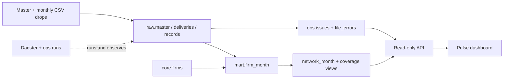

# Pulse

Phase 1 of the Demo Data Engineer assignment: CSV deliveries → validated monthly
metrics → read-only API → one internal dashboard. Runs locally or on an on-premise
Docker host. No cloud account, API key, LLM or Phase 2 dependency.

## Start

Prerequisite: Docker Engine/Desktop with Docker Compose v2 and Linux containers.
The first build needs internet access to download public images and pinned packages.
Allow roughly 4 GB of available RAM and a few GB of disk space. From this repository:

```sh
docker compose up
```

Compose creates PostgreSQL, applies checksum-verified migrations, loads the supplied
data through Dagster, and starts the API/dashboard, Dagster UI and scheduler daemon.
No `.env` file or manual database setup is needed. Startup waits for healthy database
and successful bootstrap. For background mode: `docker compose up -d --build --wait`.

- Dashboard: http://localhost:8000
- Interactive API documentation: http://localhost:8000/docs
- Dagster: http://localhost:3000 — asset `monthly_metrics`, job `ingest_all`

To ingest again, including newly added files:

```sh
docker compose run --rm bootstrap pulse ingest
```

Place new deliveries in `data/drops/`. The directory is mounted read-only in the
application containers; no image rebuild is necessary for new CSV files. Write to
a temporary filename such as `.partial`, then atomically rename it to `.csv` once
the delivery is complete. Do not write an unfinished delivery directly to a `.csv` path.

The enabled Dagster **`csv_delivery_sensor`** checks the folder at a minimum interval
of 30 seconds. A file must have the same size, modification timestamp and SHA-256 in
two consecutive observations before it becomes eligible. New stable files are batched
into one `ingest_all` run with explicit filenames and expected checksums. Typically
pickup takes around 30–60 seconds plus daemon/queue overhead; it is not a latency SLA.
Open Dagster → Automation → Sensors to inspect ticks, skip reasons, runs or pause it.

The sensor consults the ingestion ledger, so loaded files and unchanged quarantined
contents do not trigger repeated ingestion. Its persisted cursor and run keys deduplicate
repeated observations. It defers while an ingestion job is queued or active, and the
database lock still protects overlapping entry points. A file changed after inspection
fails its expected-checksum check before archival. Two stable observations are a heuristic;
the producer's atomic rename is the file-completion contract.

Transient ingestion/publication exceptions receive two step retries, five seconds apart.
Known file-quarantine outcomes fail visibly without automatic step retries. Fix the input
or re-execute the failed run in Dagster. An exhausted unchanged arrival is not endlessly
resubmitted by the sensor. The daily **06:00 Europe/Madrid** schedule and manual full-run
command remain available for reconciliation and recovery, including archived data whose
publication previously failed. The lab's playback stays manual and isolated; this sensor
does not automatically fill the lab database.

By default, only loopback ports 8000 and 3000 are exposed. PostgreSQL has no published
port. If those ports are busy, set `PULSE_PORT` and/or `DAGSTER_PORT` in your environment
or in a local `.env` file. The checked-in credentials are local demonstration defaults.
Before opening this service on an office network, configure real secrets, HTTPS and
authentication/authorization; Dagster is an administrative interface.

Stop without losing data: `docker compose down`. PostgreSQL's named volume retains
the data and Dagster run history. **Destructive clean reset:** `docker compose down -v`
removes this Compose project's database volume; use only when intentionally rebuilding.

## Components and why they exist

| Component | Responsibility | Choice |
|---|---|---|
| Python CSV adapters | Read two explicit contracts, parse precise numeric values and validate rows | Small, pure functions that can be tested without a database; no dataframe framework needed for 18k rows |
| PostgreSQL | Raw archive, quality audit, firm dimension and monthly facts | One transactional system supports provenance, atomic publication and the API |
| SQL migrations | Version database schemas and reporting views | Numbered, checksum-verified files; applied transactionally under a migration lock |
| Dagster OSS | Daily schedule, manual reruns, persisted execution logs and asset check | Fits the company's existing tooling and runs without a cloud service |
| FastAPI | Read-only metrics and operational endpoints with OpenAPI | Shared Python codebase, parameter validation and bounded queries |
| HTML/CSS/JavaScript | Single internal view consuming the API | No frontend build chain, CDN or extra service; design stays focused on numbers and quality |
| Docker Compose | Provision and connect all local services | Reproduces the evaluator's startup without manual steps |
| pytest + Ruff + GitHub Actions | Prove correctness, enforce code checks and build deployable images | Tests exercise PostgreSQL and the actual Compose stack, not only mocks |

See [the implementation walkthrough](docs/walkthrough.md) for a defense-oriented
explanation and [the data contract](docs/data-contract.md) for every quality decision.

## Data model and execution



The business grain is one firm per month. Source files and all original CSV values
are retained alongside normalized records, their validation policy version and
their source line. The published row links directly to its winning source record.
The master is a current/static dimension; it cannot support historical staff counts
or historical province changes that were not supplied.

1. Acquire a database advisory lock and record the run.
2. Validate/load the clean master; preserve its original bytes.
3. Discover CSV files and compare checksums with the delivery ledger.
4. Archive and validate each new delivery in its own transaction.
5. Atomically rebuild the small reporting fact from all accepted historical versions.
6. Record completion and check that every published row has an accepted source.

Delivery precedence is `(filename delivery month, explicit revision)`, independent
of ingestion order. Repeated files do not duplicate raw rows or issues. A run always
creates a new operational audit entry, even when all files are skipped: idempotence
means identical business results and source inventory, not suppressing execution logs.

Reporting publication uses a transaction with DELETE + INSERT, so readers see an old
or new complete fact table, never a partially filled table. Raw archival transactions
survive a subsequent publication failure; the last successful reporting state remains
available. A retry republishes from that retained raw history. File-level errors are
retained with bytes; a partial run publishes valid inputs but signals failure in Dagster.
Row rejections are expected quality outcomes, reported explicitly rather than crashing
every run. A crashed worker's abandoned run is marked on the next lock-owning attempt.

At this size, incremental raw ingestion plus a deterministic reporting rebuild is
easier to validate than incremental aggregate updates. There is no Kafka, Spark,
Kubernetes or dbt dependency; they would add operational burden without solving a
current requirement. SQL transformation code is versioned in Git and tested in CI.

## Optional CSV playback lab

Start a separate, initially empty lab alongside the normal dashboard:

```sh
docker compose --profile lab up -d --build --wait lab
```

Open **http://localhost:8001** (or the dashboard's **Laboratorio** link). The lab has
its own PostgreSQL service, Docker network and persistent volume. Its writer cannot
address the main database through that network. `LAB_PORT` changes the browser port.
The original CSV mount remains read-only. Starting the lab loads the firm master,
but does not ingest any monthly delivery until requested.

1. Move the playhead to a delivery. Scrubbing never writes or rewinds the database.
2. Choose **Seleccionar hasta el cursor**, individual checkboxes, or **Todos**.
3. Reorder the selected queue with ↑/↓ or **Invertir selección** to test late arrivals.
4. Choose a delay and **Reproducir selección**, or load just the CSV at the cursor.
5. Watch counts, monthly totals, quality issues and per-file evidence update live.
6. Replay the same selection. Files should say **Omitido**, with unchanged raw counts
   and the same business-data SHA-256. A new execution audit record is still expected.

Pause and stop finish the current CSV before taking effect. Resume preserves the
remaining queue; after a process restart, interrupted work becomes paused and can
be retried. The request UUID makes an HTTP submission retry return the same job.
Only one active playback is allowed, and the existing ingestion advisory lock still
protects publication. Playback controls accept only catalog filenames, never client paths or SQL.

Each CSV calls the **same `ingest()` function** as the production Dagster asset, with
an explicit file selection and lab database connection. The lab's durable playback
worker replaces the schedule for this experiment; it does not claim these interactive
runs appear in the main Dagster instance. Parsing, archival, validation, winner selection
and atomic publication are shared. Raw ingestion inserts only unseen deliveries;
reporting still rebuilds transactionally at this small volume.

Evidence records added/changed/removed firm-months, before/after raw counts and business
hashes, run IDs, and checks for unique keys, accepted sources and latest-valid winners.
Business hashes exclude execution/source row IDs so differing arrival orders can be
compared. They are verification fingerprints, not tamper-proof audit signatures. A retry
after failed publication may skip an already archived file while repairing reporting;
that case is labeled **Recuperación**, not an unchanged replay.

**Reiniciar laboratorio** explicitly confirms clearing only lab deliveries, reporting
and playback history; it retains the master and source files. It is disabled during an
active file. Moving the playhead backwards never performs this reset. Read-only metric,
quality and lineage APIs are also available on port 8001, against the lab database.

The optional lab is a local development tool with polling once per second and no user
authentication. The loopback binding, same-origin action header and fixed DB connection
are intentional; it is not a multi-user production ingestion control plane.

CI starts a disposable lab, loads all 36 drops one by one, replays all 36 in reverse,
checks every skip and unchanged hash/counts, then clears that test lab. The smoke script
requires an initially empty lab and an explicit `--disposable` flag. Do not run it against
an experiment whose evidence you intend to retain.

CI also adds a temporary revision to its disposable main stack and verifies that the
actual Dagster daemon ingests it automatically, records the sensor trigger, and does not
launch more ingestions on subsequent unchanged observations. `scripts/sensor_smoke.py`
requires `--disposable`; its database keeps the test revision until the test stack is removed.

### Query the lab with PostgreSQL

Open **http://localhost:8001/#sql-console** or click **SQL** in the lab header.
Write a query and press **Ejecutar SQL** or **Ctrl/Command + Enter**. If text is
selected, only that selection runs. The schema browser lists actual tables, columns,
types and primary keys; click a name to insert it at the cursor. **Ver plan** runs
EXPLAIN without ANALYZE. Examples insert editable SQL and never execute automatically.
The browser retains the editor draft locally. Results are a snapshot taken when you
run the query; run it again to see deliveries loaded since then.

```sql
SELECT f.asesoria_id, f.mes, f.clientes_activos,
       f.facturacion_asesoria_eur, d.filename AS source_csv, r.line_number
FROM mart.firm_month f
JOIN raw.records r ON r.id = f.source_record_id
JOIN raw.deliveries d ON d.id = r.delivery_id
ORDER BY f.mes DESC, f.asesoria_id;
```

`core.firms` contains the master even before playback. `raw.deliveries` and
`raw.records` show archived inputs and versions; `mart.firm_month` shows the current
winning record per firm/month. `ops.issues` explains validation and `ops.runs` shows
loaded/skipped files per execution. `lab.jobs` and `lab.steps` expose playback evidence.
Repeated firm/month keys across raw deliveries can be legitimate corrections;
the published fact has a unique `(asesoria_id, mes)` key.

The editor sends SQL directly to PostgreSQL using `pulse_reader`, with a read-only
transaction that is rolled back after each request. PostgreSQL's
[DECLARE grammar](https://www.postgresql.org/docs/17/sql-declare.html) accepts SELECT,
WITH, VALUES and TABLE queries; extended-protocol preparation rejects multiple statements.
Use the plan button instead of writing EXPLAIN in the editor. No owner credentials,
DDL/DML, transaction control or psql backslash commands are exposed through this endpoint.
The main dashboard has no SQL endpoint.

Queries have a five-second deadline, two simultaneous execution slots, a maximum of
1,000 displayed rows and a 2 MB returned-value budget. Truncation is explicit; aggregate,
filter or paginate in SQL to inspect larger results. Values use PostgreSQL's text
representation, preserving decimal/bigint precision, JSON and duplicate column names;
NULL stays distinct from an empty string. Query errors include PostgreSQL's SQLSTATE.

For a terminal session in the same read-only database:

```sh
docker compose exec lab-db psql -U pulse_reader -d pulse_lab
```

## Reporting API

| Endpoint | Returns |
|---|---|
| `GET /health` | Database/schema reachability |
| `GET /api/v1/firms?search=...` | Firm directory |
| `GET /api/v1/firms/{id}/metrics?start=YYYY-MM&end=YYYY-MM` | Monthly series, missing-month markers and winning source |
| `GET /api/v1/network/metrics?start=YYYY-MM&end=YYYY-MM` | Monthly totals, coverage and contributor counts |
| `GET /api/v1/quality/summary` | Raw/accepted/rejected/duplicate/published counts, last run and last incorporation |
| `GET /api/v1/quality/deliveries` | Per-file counts, format version and checksum |
| `GET /api/v1/quality/runs` | Execution history, timestamps and outcomes |
| `GET /api/v1/quality/issues?severity=error&firm_id=...` | Original values, filename, line and rejection/warning reasons |
| `GET /api/v1/quality/gaps` | Missing eligible firm-months |
| `GET /api/v1/quality/file-errors` | Malformed or mutated file incidents, including resolution status |
| `GET /api/v1/lineage/{id}/{YYYY-MM}` | Delivery versions, reasons and the selected source record |

List responses use `{items,total,limit,offset}`; limit is 1–500. Month bounds are
inclusive. Invalid parameters return 422, unknown firms return 404. Money is an
exact decimal string in JSON. Missing data is NULL, not zero. A missing-month gap
differs from a legitimate record containing zero values. The API connects with a
database reader role, starts read-only transactions and enforces a query timeout.

The screen shows the last month's values within the selected range, not a misleading
sum of active customers over time. Quality counts refer to ALL ingested deliveries,
as explicitly labeled, independently of the chart filter.

The dashboard's dark slate palette, blue accents and typography follow the author's
[technical portfolio](https://me.alejandrofranks.workers.dev/tech). Inter Tight and
JetBrains Mono are bundled locally with their SIL Open Font Licenses in
`src/pulse/static/`; loading the dashboard makes no font/CDN requests. Scrollable
tables retain their column headers, and coverage/error colors reflect API values.

## Tests and CI

```sh
docker compose build test
docker compose run --rm test ruff check src tests scripts
docker compose run --rm test ruff format --check src tests scripts
docker compose run --rm test pytest -q -p no:cacheprovider
docker compose run --rm test python scripts/profile_data.py
```

Integration tests use the separate `pulse_test` database; they refuse to reset any
database whose name does not end in `_test`. They cover old/new formats, decimals,
nulls, legitimate backlog, invalid values, duplicate conflicts, corrections arriving
out of order, invalid-latest fallback, file mutation, explicit revisions, concurrent
ingestion protection, API errors, gap semantics, idempotence and independent CSV
reconciliation of all 36 monthly revenue and active-client totals.

For development-only dashboard DOM checks against the running API, use Node 22+:
`npm ci` then `npm test`. These exercise rendering, filters, lineage, gaps and API
failure feedback using jsdom. Node is not needed to run the delivered application.

The CI workflow runs those checks, builds the runtime image, starts the full Compose
stack, verifies real HTTP responses, ingests again and compares stable published
results. It uploads service logs and tears down its disposable database. There is
no automatic deployment to an external server because no target was supplied.

Dependencies are pinned transitively in `requirements*.txt`. Update the `.in` files
and regenerate with pip-tools under Python 3.12, then run the complete CI. Dagster's
PostgreSQL metadata connection explicitly uses psycopg2; business ingestion uses
psycopg 3. SQLAlchemy 2.0 is pinned for the selected Dagster release.

## Technical decisions requested by the brief

### 1. What was left out, and what comes next?

Phase 2 is intentionally excluded. No cloud provisioning or Terraform bonus, SSO,
production secret manager, managed backups, external alert routing or multi-node HA.
For an office deployment, add reverse-proxy authentication, secrets, encrypted backups
with restore drills, resource limits and failure notifications. Agree business ownership
of the quality rules before tightening them. A changed master currently needs an
explicit controlled migration; add versioned master deliveries/SCD only when required.

### 2. What is most fragile?

The producer contract: filenames currently encode delivery order, monthly revenue
is assumed nonnegative, and no manifest declares completeness. Unknown schemas and
mutated deliveries fail visibly, but no pipeline can infer an undocumented correction's
intent. First improvement: a producer manifest with immutable delivery ID, revision,
schema version, expected firm coverage and checksum, agreed with the source owner.
Then add operational alerts. The daily schedule cannot discover files absent from disk;
missing expected deliveries need a delivery-calendar SLA, not a guessed warning.

### 3. A firm's revenue is wrong: how do we locate the failure?

1. Retrieve its firm-month API response and `/lineage/{id}/{month}`.
2. Inspect the selected record, competing deliveries and quality decisions. Check for
   a rejected newer correction or missing revenue category.
3. Compare normalized numeric fields with the raw payload, source filename, CSV line
   and archived file checksum. If the source is wrong, request a new delivery/revision.
4. Compare `mart.firm_month` with the expected Decimal sum and winning version. A mismatch
   here is parsing, validation or precedence logic; add a regression fixture, fix and replay.
5. Compare API JSON with SQL results. A mismatch here is query/serialization logic;
   correct it and test the endpoint. Finally inspect dashboard formatting/filtering.

The source is never silently edited to make a test pass.

### 4. What changes at 5,000 firms submitting daily?

5,000 daily metric rows is still modest for PostgreSQL. The first problems are likely
file count/coordination, re-reading all files to checksum them, Python row-by-row audit
insertion, and rebuilding an ever-growing fact under one writer lock. Measure before
introducing distributed compute.

Introduce immutable manifests and event-driven file discovery, archive file bytes in
object storage or an on-premise compatible store, load staging in bulk with COPY, and
update only affected firm-month keys using explicit delivery precedence. If the business
grain becomes DAILY, create a daily fact and define how monthly stocks/flows aggregate;
do not just rename the monthly column. Partition history when measured retention/size
warrants it, add API pooling/caching and richer source SLAs. Scale workers by nonoverlapping
delivery keys, keeping publication transactional and retries idempotent.

## Delivery

Development uses descriptive `feat/<change>` branches and pull requests into `main`.
The initial source-contract commit is the baseline. `feat/data-platform` adds the
working pipeline, database, API and dashboard; `feat/verification-and-docs` adds
end-to-end CI, dashboard checks and the defense guide. The latter initially builds
on the former, so its CI verifies their combined result. Pull requests are merged
with merge commits to preserve this progression; the demonstration branches are
retained for review. New work should branch from the latest `main` and keep each
coherent, verified change in a separate commit. CI runs for pull requests and `main`;
this workflow does not imply that branch protection or human approval is configured.

This history has been prepared for a public portfolio edition.
