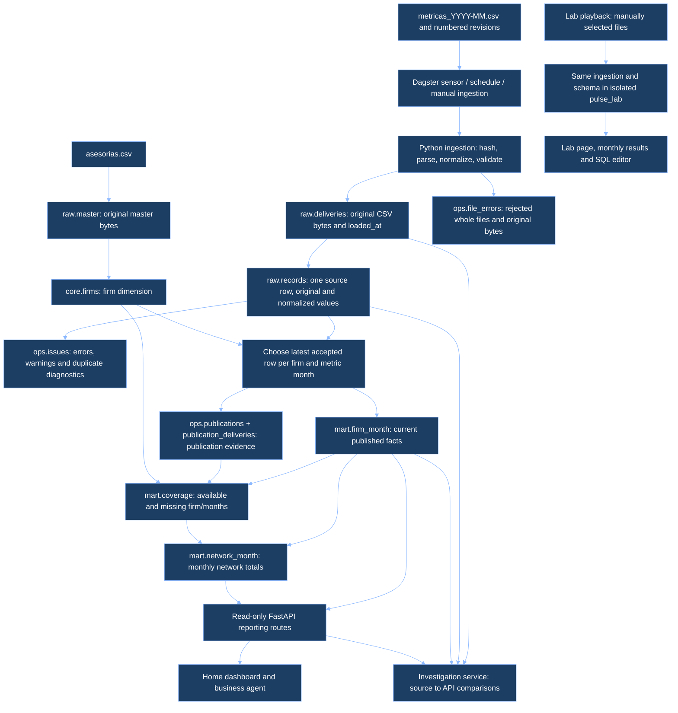
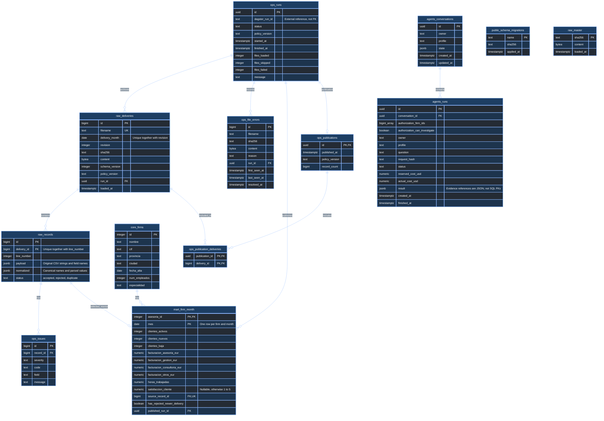
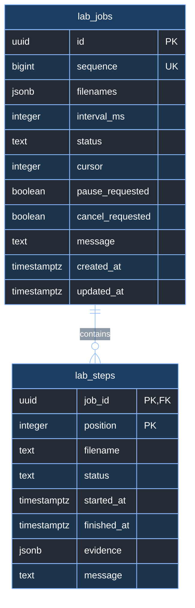

# Pulse database map and SQL guide

The main application uses PostgreSQL database `pulse` (port 8000 API). The playback
lab uses a separate database, `pulse_lab` (port 8001 API). They use the same business
schema and ingestion code, but have independent data, IDs and publication histories.
The lab additionally has `lab.jobs` and `lab.steps`.

## From files to the screen



New files are archived incrementally. Publishing rebuilds the small current fact
table in one transaction: readers see the previous or next complete publication.
Rejected rows remain queryable in raw; they cannot become current facts. If a newer
delivery is invalid, an older accepted fact can remain with
`has_rejected_newer_delivery = true`. If there is no valid candidate, coverage is
missing. Missing is not zero.

`mes` is the **business month**. `raw.deliveries.loaded_at` is **when the file was
archived**; `ops.publications.published_at` is **when it was published**. These times
answer different questions. Changing the lab cursor selects files; it does not
rewind the database. Publication membership supports historical reconstruction;
`mart.firm_month` itself holds only the current result.

## All application tables and foreign keys

This diagram covers all 13 application tables in `pulse`. Key and representative
data columns are shown; exact complete column definitions are in the linked
migrations below. `PK` = primary key, `FK` = foreign key, `UK` = unique key.
Relationships here are actual SQL foreign keys, not inferred joins inside JSON.
An unconnected table is intentional.



Diagram identifiers replace the schema separator with `_`: `raw_records` means
SQL table **`raw.records`**, for example. `mart.firm_month` also stores declaration,
consultation, incident and document counts; see its complete definition in
[001_core.sql](../backend/01_pipeline/src/pulse/migrations/001_core.sql).
The master archive produces `core.firms` through ingestion, without a foreign key.
Raw JSON has no foreign key to firms, so it can retain invalid customer IDs.
One raw row can have several issues: joining all issues before summing revenue
would duplicate amounts. Use `EXISTS` when you only need to filter affected rows.

| Relation | One row means |
| --- | --- |
| `public.schema_migrations` | One applied, checksummed migration |
| `raw.master` | One archived master file checksum |
| `core.firms` | One advisory firm; current static dimension, not SCD2 |
| `ops.runs` | One ingestion attempt |
| `raw.deliveries` | One successfully parsed delivery file/revision |
| `raw.records` | One CSV line, including rejected and duplicate lines |
| `ops.issues` | One diagnostic for one source line |
| `ops.file_errors` | One quarantined filename/checksum/reason combination |
| `mart.firm_month` | One currently published firm/month |
| `ops.publications` | One completed publication transaction |
| `ops.publication_deliveries` | One delivery available to one publication, including rejected candidates |
| `agents.conversations` | One agent conversation |
| `agents.runs` | One agent request and its cost/result audit |

There are also **three views**, calculated from the tables rather than separately
loaded: `raw.record_identity` identifies firm/month for diagnostic queries,
including some malformed rejected rows; `mart.coverage` exposes expected
firm/months and whether they have a fact; `mart.network_month` aggregates each
month with coverage and contributor counts. Its `revenue_eur` is the sum of the
four revenue components. `revenue_eur` is not a column of `mart.firm_month`.

Additional schema definitions:
[reporting views](../backend/01_pipeline/src/pulse/migrations/002_reporting.sql),
[publication evidence](../backend/01_pipeline/src/pulse/migrations/003_publication_evidence.sql),
[agent storage](../backend/01_pipeline/src/pulse/migrations/004_agent_runtime.sql),
[record identity](../backend/01_pipeline/src/pulse/migrations/005_rejected_record_identity.sql).
`public.schema_migrations` is created by
[db.py](../backend/01_pipeline/src/pulse/db.py).

## Additional tables in the isolated lab



One job is an ordered playlist; one step is one file in that playlist.
`lab.steps.evidence` records before/after counts, integrity and replay results.
There are no cross-database foreign keys. Dagster separately maintains its own
framework-managed `dagster` database for orchestration state; it is not the
business data store depicted above. Test runs use disposable `pulse_test` data.

## Where and what to query

- Lab: open `http://127.0.0.1:8001/#sql-console`. Queries run against **only the lab's
  loaded files**. Run one SQL statement at a time, or select the statement first.
- Main: from the repository terminal, run
  `docker compose exec db psql -U pulse_reader -d pulse`. This reads the same
  business database as the main dashboard. There is no SQL editor endpoint on
  the main API. The reader cannot access private `agents.*` conversation tables.
- Always qualify table names with their schema, for example `mart.firm_month`.
  The lab editor's table browser lists the actual readable columns.

**Satisfaction:** the canonical field is `satisfaccion_cliente`. Valid non-missing
values are 1 through 5, inclusive. `<= 1 OR >= 1` matches every non-null numeric
value; invalid values require **`< 1 OR > 5`**. `NULL` requires `IS NULL`.

```sql
-- Published valid records with the lowest possible score.
SELECT *
FROM mart.firm_month
WHERE satisfaccion_cliente <= 1
ORDER BY mes, asesoria_id;

-- This must return no rows: these values are rejected before publication.
SELECT *
FROM mart.firm_month
WHERE satisfaccion_cliente < 1 OR satisfaccion_cliente > 5;
```

To inspect **rejected** scores such as `8,4`, query the raw archive and its recorded
validation rule. This avoids casting arbitrary CSV strings to numbers and avoids
counting a source row twice if it has multiple diagnostics:

```sql
SELECT r.id AS record_id,
       r.normalized->>'asesoria_id' AS asesoria_id,
       r.normalized->>'mes' AS mes,
       COALESCE(r.payload->>'satisfaccion_cliente',
                r.payload->>'satisfaccion_media') AS original_score,
       r.normalized->>'satisfaccion_cliente' AS normalized_score,
       r.status, d.filename, r.line_number, d.loaded_at
FROM raw.records r
JOIN raw.deliveries d ON d.id = r.delivery_id
WHERE EXISTS (
    SELECT 1 FROM ops.issues i
    WHERE i.record_id = r.id AND i.code = 'satisfaction_range'
)
ORDER BY d.loaded_at, r.line_number;
```

`payload` preserves the input name and comma decimal; `normalized` uses the
canonical name. JSON `->>` extracts text. Empty optional satisfaction is a
different case: query `mart.firm_month WHERE satisfaccion_cliente IS NULL`.
For other rejection causes inspect `ops.issues.code`, `field` and `message`.

Copyable queries for satisfaction, revenue, provenance and the live schema are in
[database-queries.sql](database-queries.sql). A record ID from the main dashboard
need not exist in the lab: identify business data using firm and month instead.
