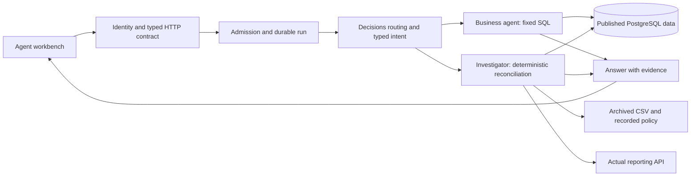

# Phase 2: two agents, shared evidence

The business assistant and data investigator are bounded workflows over the same
published PostgreSQL data. They share intent planning and operational controls,
but execute different tools. Financial figures never come from generated prose.

## Components and organization

| Location | Responsibility |
|---|---|
| `backend/01_pipeline` | Raw ingestion, publication and reproducible migrations |
| `backend/02_api/src/pulse_api/investigation.py` | Independent source-to-API evidence |
| `backend/02_api/src/pulse_api/agent_api.py` | HTTP contracts, identity and same-origin checks |
| `backend/04_agents/src/pulse_agents/schemas.py` | Closed, typed intent contract |
| `backend/04_agents/src/pulse_agents/provider.py` | Bounded OpenAI routing/planning or explicit demo plans |
| `backend/04_agents/src/pulse_agents/analytics.py` | Metric catalogue, fixed parameterized SQL and exact arithmetic |
| `backend/04_agents/src/pulse_agents/runtime.py` | Two tool workflows and deterministic answers |
| `backend/04_agents/src/pulse_agents/store.py` | Conversations, run evidence, retry identity and shared admission |
| `frontend/03_agents` | Chat, investigation controls and inspectable SQL/evidence |

The runtime performs at most one Decisions routing request and one Responses
planning request. There are no autonomous loops, model-written SQL, shell tools,
automatic repairs or automatic provider retries. Decisions confidence is recorded
for diagnostics; it grants no authority. `PULSE_USE_DECISIONS=false` disables that
optional routing call while retaining deterministic validation and authorization.

The business tool supports total revenue, active clients, new clients, departures,
income-tax declarations and worked hours. Operations are monthly series, totals,
rankings and explicitly defined consecutive active-client declines. Active-client
stocks cannot be totaled across months. A decline of N months requires N+1
consecutive non-null observations. Revenue is the sum of all four billing categories;
cash receipts, profit, component-only billing and NRR are outside this initial plan.
Definitions, query parameters, coverage and result truncation are returned with SQL.

The investigator currently handles **one firm, one month, total revenue**. It
calls the deterministic service described in `investigation-service.md`. Its
conclusion is rendered from checks, not inferred by an LLM from a few log lines.
All comparisons and source versions remain available for inspection.

## Memory and reproducibility

PostgreSQL stores conversation ownership/profile, the preceding validated intent,
recent user questions, request identity and completed evidence. Numeric answers
are not copied into conversation memory as current truth. Every new request runs
its tools again against a consistent publication. Retrying the **same request ID**
returns the saved result, clearly marked as replayed; changed content or permissions
under that ID is rejected. Separate agents use separate conversations.

A run records the plan, SQL, source references/publication, result, model mode,
prompt version, implementation hash, token usage and estimated cost. A model alias
is not an immutable training snapshot; revisions are tracked in Git and behavior must be reevaluated
on upgrades. No hidden model reasoning is requested or stored. Original publication
membership is available from migration 003 onward; historical screen states are
not reconstructed. New manifests do not fabricate older publication history.

## Safety and deployment scope

The model has no database connection. Analytics and investigation use reader
connections and fixed SQL. A separate `pulse_agent_writer` role can write only the
agent operational tables. Its credentials are never passed into a query tool.
Secrets are read only by the provider adapter and never returned to the browser.

Default Compose is an **internal single-operator demo**, bound to loopback. The
custom POST header, same-origin check and trusted hosts prevent browser form and
DNS-rebinding access; they are not a substitute for user authentication.

For agent-route identity isolation, `PULSE_AGENT_IDENTITIES_FILE` can point at a
server-managed JSON array. Each entry contains a unique `subject`, SHA-256 of its
bearer token (`token_sha256`), `firm_ids` (null for the full internal network, [] for
no firms), and `can_investigate`. No plaintext tokens belong in this repository.
The API derives scope from this configuration, never from model output or request
JSON. Invalid configuration fails closed. Conversation ownership and cached-response
permission scope are checked again on every request. Forensics additionally requires
full internal operational access because shared file evidence can include other firms.

This is not a claim that every Phase 1 endpoint is multi-tenant. Before broader
deployment, put all internal reporting/lab/Dagster routes behind an authenticated
operator boundary and expose only authorized agent routes to end users. Replace
the local token adapter with SSO, enforce tenant policy across the platform, provision
real database credentials and TLS, and agree audit retention/deletion and backups.

## Cost, deadlines and overload

Admission is serialized through a short PostgreSQL advisory-lock transaction:
four active agent runs globally, one active run per conversation, and 60 requests
per operator per hour. The database connection closes before model requests.
The default UTC-day estimated model budget is USD 0.50, configurable with
`PULSE_AGENT_DAILY_BUDGET_USD`. Each live request reserves USD 0.01 before work;
successful known usage settles the estimate. Unknown usage, failed requests and
interrupted workers retain their reservation conservatively. This is an application
budget, not the provider account's balance or a billing guarantee across other apps.

Each provider call has a 15-second socket timeout and a 256 KiB response limit.
The two encoded provider requests share a 24 KiB input budget; Responses generates
at most 1,200 tokens. The request has at most two provider calls. Analytics has a bounded execution budget, statement/lock
timeouts and 100 result rows; investigation has its own explicit evidence limits.
No unbounded background queue is created. Capacity errors are visible and repeated
request IDs do not trigger a second accepted model execution.

Cost estimates use the documented GPT-6 Luna rates checked on 2026-10-19:
USD 0.10 per million input tokens and USD 0.50 per million Responses output tokens;
Decisions has no output charge. Unknown usage remains unknown. Region premiums,
caching and future pricing changes require updating this estimate. The adapter's
network dependency is OpenAI; PostgreSQL, API, orchestration and evidence stay local.
Only questions, intent context and schema instructions go to the model, not source
CSV contents, financial result tables or investigation evidence.

## Why there is no vector database

Firm IDs, months, amounts and provenance relationships require exact SQL retrieval.
The small metric catalogue is directly supplied as a controlled contract. Adding
embeddings would introduce another freshness and permission problem without helping
these exact lookups. No training or backpropagation occurs during normal requests.

When runbooks, data contracts and incident documents grow, add a separate Dagster
indexing pipeline: approved source -> versioned sections -> permissions/validity
metadata -> full-text and optional pgvector embeddings. Chat retrieves authorized
sections, ranks and bounds evidence, and cites original sources. Document deletion
and permission changes must invalidate indexes and caches. Benchmark retrieval
recall and answer support independently before enabling a reranker or new store.

## Scaling path and validation

API processes can be replicated because conversations, idempotency and admission
are database-backed. Per-process investigation limits remain an additional bound.
Measure peak request rate, input/output tokens, p50/p95 latency, queue rejection,
database time, coverage, provider failures and cost per completed answer. More API
replicas do not remove provider quotas or database bottlenecks.

Next steps when justified by measurements: pool database connections, introduce
bounded durable workers for longer investigations, separate retrieval indexing,
and add read replicas with explicit publication/freshness checks. Cache keys must
include permission scope, normalized intent, metric definition and publication.
Kubernetes, a message broker, distributed tracing infrastructure and document RAG
are not prerequisites for this small deployment.

CI uses deterministic demo plans and mocked provider boundaries: no paid key is
required. It tests real PostgreSQL arithmetic/coverage, SQL parameterization,
corrected and absent data, ownership, retries, limits, hostile inputs and provider
errors. A live model check is a separate opt-in evaluation, not proof of general
semantic accuracy. Maintain labeled typical, ambiguous and adversarial questions
and rerun them when the model, prompt, schema or data contract changes.

The workbench keeps results and revenue comparisons above expandable evidence.
Its 34 DOM cases include literal rendering of hostile content, independent agent
conversations, response validation, credential changes during in-flight work,
request recovery with the exact original payload, and decimal-string cost display.
An isolated browser check also exercised both real demo workflows at desktop and
mobile widths, with no JavaScript errors or document overflow. CI checks all three
frontend interfaces and verifies that the deployed workbench assets are reachable.

Historical live evaluation results and private source evidence are omitted from this public history.
